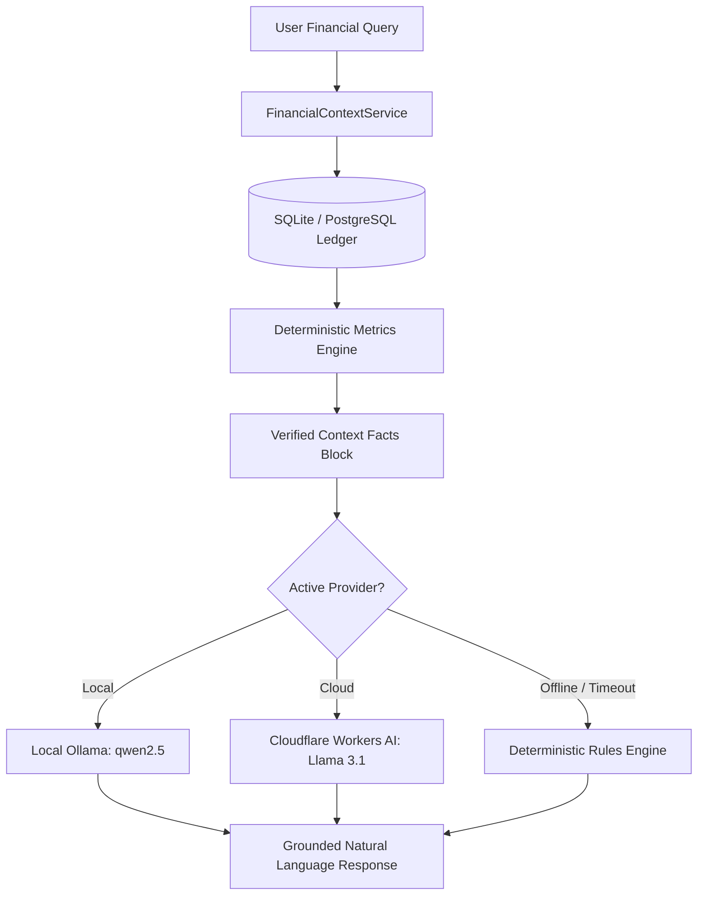

# FinSentry AI Investigator — Grounding & Context Architecture

The **FinSentry AI Investigator** transforms complex financial records, machine-learning anomaly logs, and recurring payment structures into understandable natural-language intelligence.

---

## 1. The Financial Hallucination Problem & Resolution

Commercial LLMs frequently suffer from numerical hallucinations, calculating incorrect sums, misinterpreting currency values, or inventing dates when answering financial questions.

FinSentry AI enforces a **Strict Mathematical Grounding Pipeline**:
1. **Zero Raw SQL Access**: The model is never permitted to execute arbitrary SQL or perform write/delete mutations.
2. **Deterministic Context Synthesis**: Python's SQLAlchemy engine queries SQLite, computes month-over-month differences, category surges, and cash-flow projections beforehand, and injects verified figures as read-only context.
3. **Low-Temperature Constraint**: Inference is constrained at temperature $T \le 0.15$ with strict prompt instructions forbidding ungrounded assertions.

---

## 2. Seven Audited Benchmark Queries & Explanations

The AI Investigator has been verified against the 7 primary evaluation queries:

### 1. "Why did my savings decrease this month?"
- **Context Evaluated**: Current month net savings vs. previous month net savings, category percentage surges.
- **Answer Grounding**: Flags a 44% surge in discretionary **Food & Dining** (Swiggy/Zomato), higher shopping transactions, and shows exact savings rate drop from 38% to 17%.

### 2. "What is my highest spending category?"
- **Context Evaluated**: Grouped expense sums across all recorded transactions.
- **Answer Grounding**: Identifies **Housing** as the #1 category totaling ₹1,44,000 (35.4% of total expenses), followed by Food & Dining.

### 3. "Which subscriptions are costing me the most?"
- **Context Evaluated**: Active subscriptions detected by inter-transaction variance ($25\dots 35$ days).
- **Answer Grounding**: Lists Rent Maintenance (₹24,000/mo) and Airtel Broadband (₹1,179/mo), and highlights **Scenario A**: **Netflix price hike (+₹150)** from ₹499 to ₹649/mo.

### 4. "Are there any suspicious transactions?"
- **Context Evaluated**: Isolation Forest outlier logs and duplicate candidate pairs.
- **Answer Grounding**: 
  - **Scenario C Outlier**: Croma Electronics purchase of **₹18,500** (12.3x higher than user's shopping baseline; $Z = +4.61$).
  - **Scenario B Candidate**: Two identical Amazon debits of **₹1,299** within 24 hours.
  - Distinguishes statistical outliers from confirmed fraud.

### 5. "How much can I save next month?"
- **Context Evaluated**: 30-day forward cash-flow forecast combining recurring obligations with a 90-day moving average.
- **Answer Grounding**: Projects net surplus (~₹33,000) after accounting for ₹31,400 in fixed upcoming obligations.

### 6. "Compare this month with last month."
- **Context Evaluated**: Inflow consistency, total expenses, savings delta.
- **Answer Grounding**: Details stable inflows (~₹95,000) contrasting with a ₹22,200 spike in discretionary outlays.

### 7. "Explain my financial health score."
- **Context Evaluated**: Dynamic health scoring formula (savings rate + anomaly penalties + recurring leakage ratio + budget adherence).
- **Answer Grounding**: Explains the 43/100 score, noting deductions for 14 Isolation Forest flags and active subscription leakage.
