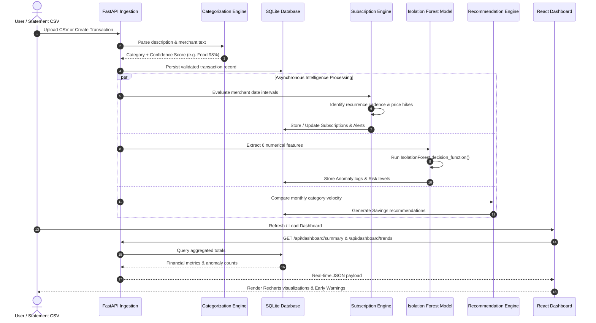

# FINSENTRY AI — TECHNICAL ARCHITECTURE

**System Design & Implementation Documentation**  
**Course:** AI for Finance (CIA-2 Assignment)  

---

## 1. COMPONENT ARCHITECTURE DIAGRAM

```mermaid
flowchart TD
    subgraph Frontend["Frontend Layer (React 18 + Vite + Tailwind CSS)"]
        UI_Overview["Overview Dashboard (Recharts + Metric Cards)"]
        UI_Ledger["Transaction Ledger (Filters, Search, CSV Import/Export)"]
        UI_Subs["Subscription Detector (Cadence & Price Hikes)"]
        UI_Anom["Anomaly Inspector (Isolation Forest & Duplicates)"]
        UI_Fore["Forecasting & Insights (7 & 30-Day Projections)"]
        UI_Chat["FinSentry Investigator (Interactive AI Assistant)"]
        UI_Settings["Settings (Demo Reset & System Config)"]
    end

    subgraph API_GW["FastAPI API Gateway Layer (/api/v1)"]
        EP_Dash["/api/dashboard/*"]
        EP_Txn["/api/transactions/*"]
        EP_Sub["/api/subscriptions/*"]
        EP_Anom["/api/anomalies/*"]
        EP_Dup["/api/duplicates/*"]
        EP_Fore["/api/forecast/*"]
        EP_Chat["/api/chat/*"]
        EP_Sys["/api/system/*"]
    end

    subgraph Service_Layer["Financial Intelligence Service Layer"]
        S_Txn["TransactionService (CRUD, CSV Parser, Deduplication)"]
        S_Cat["CategorizationService (Directory + Regex Matcher)"]
        S_Sub["SubscriptionService (Interval Analysis & Price Creep)"]
        S_Dup["DuplicateService (Temporal & Amount Clustering)"]
        S_Fore["ForecastingService (Calendar & Moving Averages)"]
        S_Rec["RecommendationService (Surge & Savings Heuristics)"]
        S_Chat["ChatbotService (Intent Router & Query Formulator)"]
    end

    subgraph ML_Layer["AI & Machine Learning Engine"]
        FE["FeatureEngineering (Log Amount, Z-Score, Day of Week, Baseline)"]
        IF_Model["Scikit-learn IsolationForest (n=100, contamination=0.05)"]
        Explain["Explainability Module (Feature Attribution & Reason Builder)"]
    end

    subgraph DB_Layer["Persistence Layer (SQLite via SQLAlchemy ORM)"]
        T_Txn[("transactions")]
        T_Sub[("subscriptions")]
        T_Alert[("alerts")]
        T_Rec[("recommendations")]
        T_Bud[("budgets")]
        T_Chat[("chat_messages")]
    end

    Frontend --> API_GW
    API_GW --> Service_Layer
    Service_Layer --> ML_Layer
    Service_Layer --> DB_Layer
    ML_Layer --> DB_Layer
```

---

## 2. DATA PIPELINE FLOW DIAGRAM

---

## 3. CORE SERVICE INTERFACES

### 3.1 Transaction Categorization Service
- **File:** `backend/app/services/categorization_service.py`
- **Method:** `CategorizationService.categorize(description, merchant, amount)`
- **Behavior:**
  1. Checks dictionary of 60+ common Indian merchants (Swiggy, Zomato, Uber, BESCOM, etc.).
  2. Runs regex rules for transaction keywords (payroll, grocery, electricity, fuel, medical).
  3. Returns `category`, `confidence`, `method`, and `explanation`.
  4. Returns `Other` with lower confidence for unknown text (no false certainty).

### 3.2 Subscription Detection Engine
- **File:** `backend/app/services/subscription_service.py`
- **Method:** `SubscriptionService.detect_and_update_subscriptions(db)`
- **Cadence:** Weekly ($5\dots 9$ days), Monthly ($25\dots 35$ days), Quarterly ($80\dots 100$ days), Yearly ($350\dots 380$ days).
- **Price Creep:** Compares latest transaction amount with running mean of previous cycles. If $+5\%$ and $\ge \text{₹}50$, flags `price_increase`.

### 3.3 Isolation Forest Anomaly Detector
- **File:** `backend/app/ml/anomaly_model.py`
- **Method:** `TransactionAnomalyDetector.run_detection(db)`
- **Safeguard:** Checks if total records $\ge 20$. If not, returns informative fallback message.
- **Explainability:** Formulates human-readable reasons comparing amount to category mean and merchant frequency.

---

## 4. API SPECIFICATION TABLE

| Route | Method | Description |
| :--- | :--- | :--- |
| `/api/dashboard/summary` | GET | Aggregates income, expenses, leakage, health score, and recent items |
| `/api/dashboard/trends` | GET | 6-month comparative trends, category pie distribution, 30-day timeline |
| `/api/transactions` | GET | Paginated, filtered, and sorted ledger |
| `/api/transactions` | POST | Records new transaction with real-time categorization |
| `/api/transactions/import` | POST | Uploads and parses bank statement CSV files |
| `/api/transactions/export` | GET | Generates downloadable CSV statement |
| `/api/subscriptions` | GET | Returns all active detected subscriptions |
| `/api/subscriptions/detect` | POST | Triggers real-time cadence and price hike re-evaluation |
| `/api/anomalies/analyze` | POST | Fits Isolation Forest and generates outlier list |
| `/api/duplicates` | GET | Detects candidate pairs with matching merchant & amount |
| `/api/forecast/30-day` | GET | Projects 30-day daily inflows, outflows, and net savings |
| `/api/recommendations` | GET | Returns prioritized behavioral savings opportunities |
| `/api/chat` | POST | Evaluates natural language query via grounded intent router |
| `/api/system/reset-demo` | POST | Resets database with 6-month calibrated benchmark dataset |

